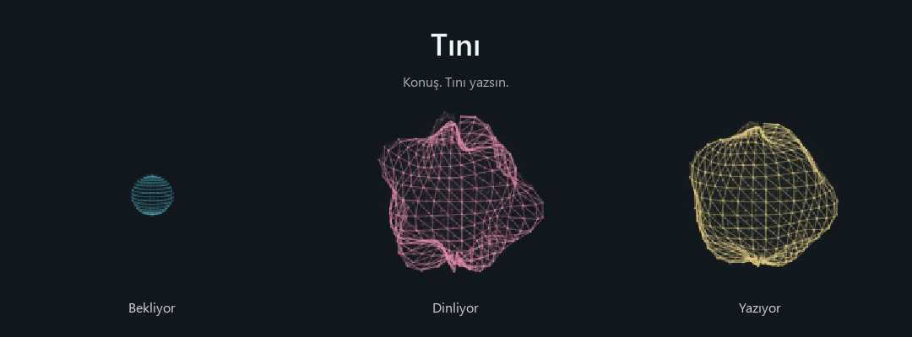

# Tını

Windows için yerel Türkçe dikte. Konuş, metnin seçtiğin alana yazılsın.

Sesinle hareket eden, sürükleyebildiğin küçük bir küre. İlk model indirmesinden
sonra çevrimdışı çalışır; ses kaydetmez, abonelik veya API anahtarı istemez.

## Kurulum

**Windows x64 · NVIDIA ekran kartı ve güncel sürücü**

1. [Kurulum paketini indir](https://github.com/ArdaFuat/tini/archive/refs/heads/main.zip) ve ZIP’i kalıcı bir klasöre çıkar.
2. **Kur.vbs** dosyasına çift tıkla. Python, paketler ve konuşma modeli otomatik hazırlanır.
3. **Tını aç** düğmesine bas. Sonrasında masaüstündeki **Tını** simgesini kullan.

Komut yazman gerekmez. İlk kurulum internet ister ve birkaç dakika sürebilir;
model yaklaşık **1,6 GB** indirilir. Kurduğun klasörü yerinde tut.

## Kullanım

- Yazmak istediğin alana tıkla; **Ctrl + Alt + Boşluk** ile dikteyi başlat / bitir.
- **Esc:** iptal · **Ctrl + Alt + Q:** çıkış.
- Küreyi sürükleyerek taşı; sağ tık menüsünden ayarlara ulaş.
- Küre kaybolursa `Baslat.vbs` dosyasını tekrar aç.

Konuşma bittiğinde metin hedef alana yapıştırılır. Hedef değişirse panoya kopyalanır.

[Performans notları](PERFORMANCE.md) ·
[faster-whisper](https://github.com/SYSTRAN/faster-whisper) ·
[Whisper large-v3-turbo](https://huggingface.co/openai/whisper-large-v3-turbo) ·
[PySide6](https://doc.qt.io/qtforpython-6/)
